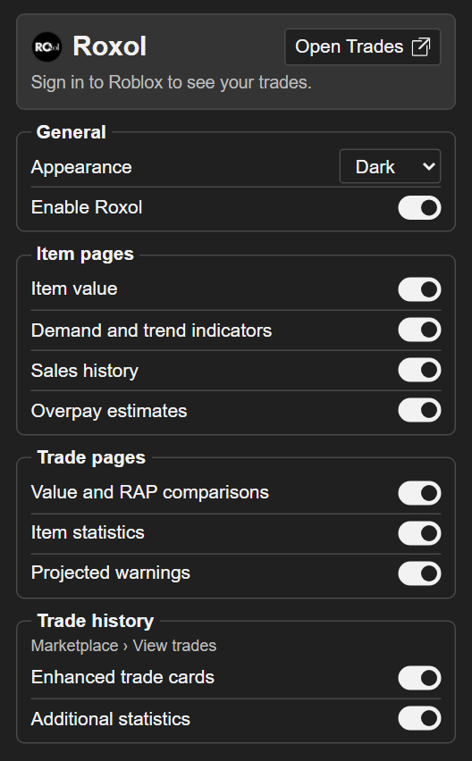
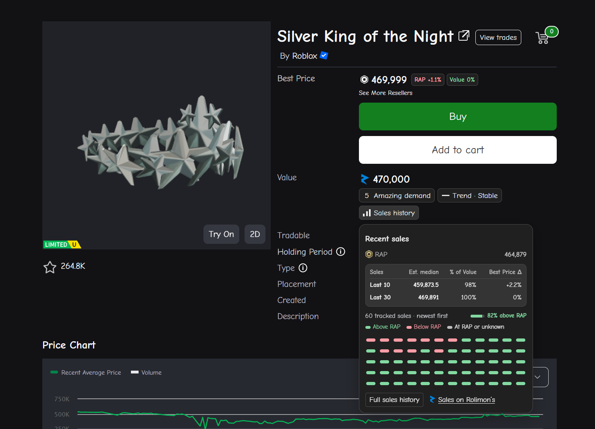
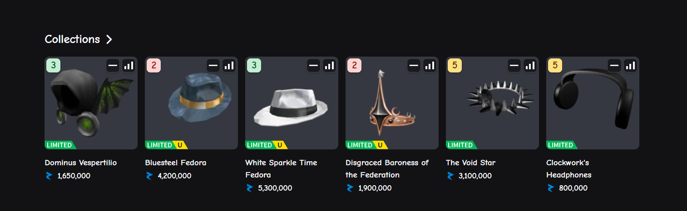
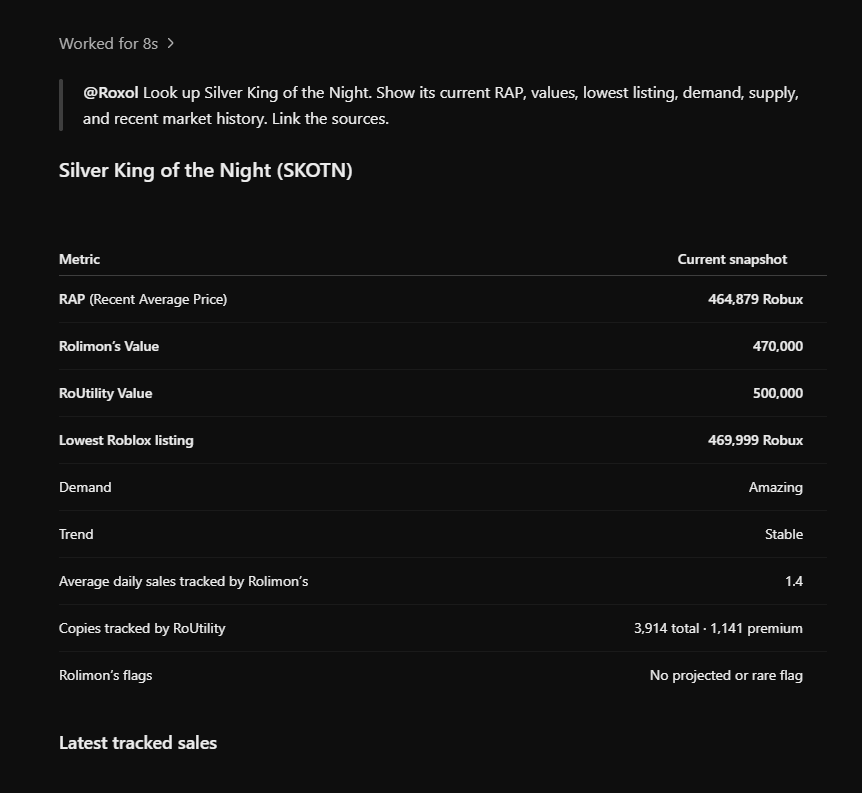
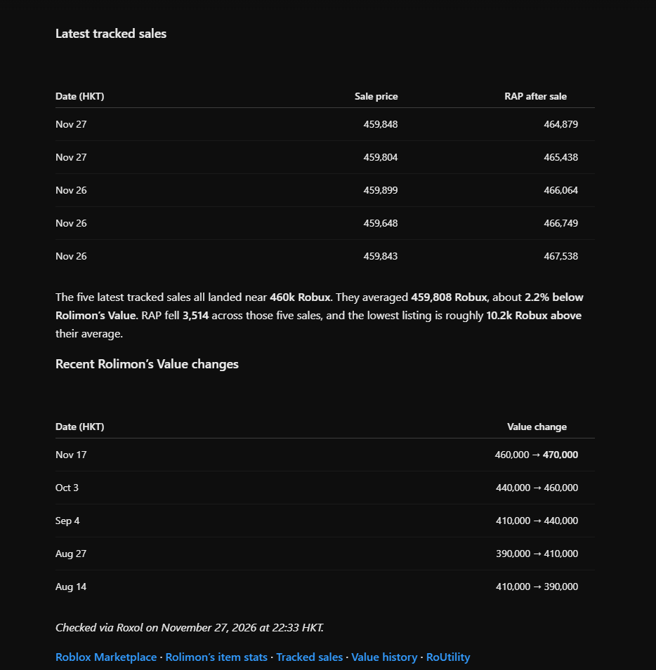
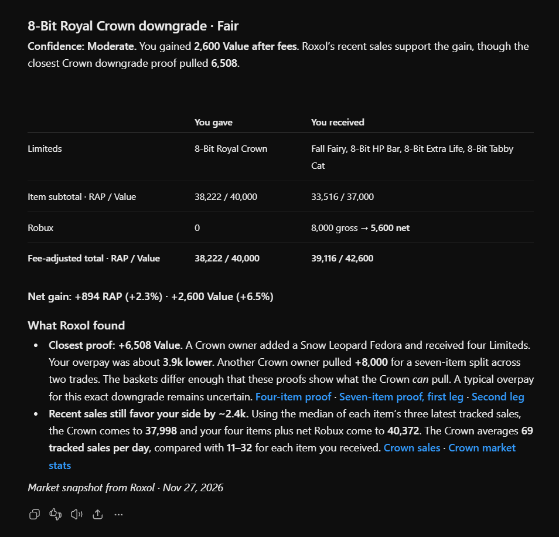
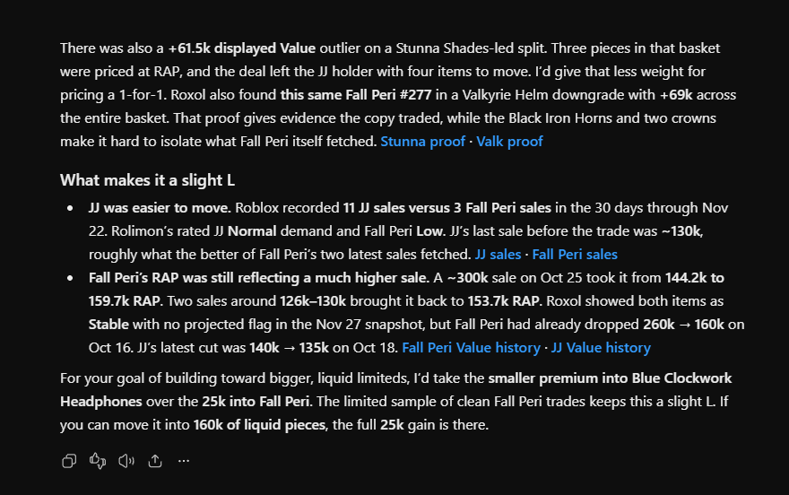

# Roxol

Roxol helps you research Roblox Limiteds and compare trades. The Chrome and Edge extension adds market data to Roblox. The Roxol MCP connector brings that data into ChatGPT, and the Roxol Trade Analysis skill uses it to assess offers and completed trades.

[Install the extension](#install-the-extension) · [Marketplace](#marketplace) · [Trades](#trades) · [Connect Roxol MCP](#connect-roxol-mcp) · [Trade Analysis skill](#roxol-trade-analysis-skill)

## Install the extension

1. Download or clone this repository. If you download the ZIP from GitHub, extract it first.
2. Open `chrome://extensions` in Chrome or `edge://extensions` in Edge and turn on **Developer mode**.
3. Select **Load unpacked** and choose the repository's `extension` folder, the one containing `manifest.json`.
4. Open or refresh a Roblox Marketplace listing. Sign in to Roblox for **Trades**, or open Roxol from the browser toolbar and select **Open Trades**.

The toolbar popup shows your Roblox sign-in status and lets you toggle item stats, sales history, trade comparisons, and other enhancements. Settings are saved in your browser profile and apply to open Roblox tabs as you change them.

## Marketplace

Open a Limited in Roblox Marketplace to check its price, recent sales, and observed trades.

- **Item metrics.** Supported Marketplace cards and item or bundle pages show **RAP** (Recent Average Price), Rolimon's assigned **Value** or a labeled fallback, and demand or average daily sales where available. Look for trend, rare, and projected indicators. **Might raise** and **Might drop** are Roxol estimates based on current RAP thresholds. On the listing, compare Roblox's **Best Price** with RAP and assigned Value when available.
- **Sales history.** Hover over or focus **Sales history** for a preview, or select it to open the full viewer. Inspect tracked sale dates, estimated sale prices, and RAP before and after each sale. The viewer compares medians for the last 10 and 30 tracked sales with Value and Best Price, and shows Roblox daily resale prices and volume where available.

- **View trades.** On supported Limited asset listings, select **View trades** to browse RoUtility's observed exchanges. Compare both sides at current Rolimon's Value, with RAP as a fallback. Expand **Valuation details** for the values, quantities, serials, and observation times RoUtility recorded where available. **Export viewed trades** saves the pages you've opened as JSON.

> **Screenshot placeholder — Observed trades.** Show the **View trades** dialog with two item baskets and expanded **Valuation details**.

Supported Roblox profiles and inventories also show RAP and Value totals for loaded copies, a paginated item breakdown, serials where available, and RoliBadges.

## Trades

Sign in and open Roblox **Trades**. Roxol adds comparisons to the trade lists, the selected trade, and the send and counter forms.

- **Scan the trade list.** In **Inbound**, **Outbound**, **Completed**, and **Closed** or **Inactive**, each trade preview puts what you give on top and what you receive below. The Robux icon marks RAP and the Rolimon's icon marks Value. Green and red indicators show gains and losses. Hover over either pair to read its totals.
- **Compare both offers.** Open a trade or build an offer to see each side's RAP, Rolimon's Value, and average demand across rated copies. The badges between the offers show the signed RAP and Value differences. Roxol counts outgoing Robux in full and incoming Robux after the trade fee.
- **Inspect individual items.** Trade and inventory-picker cards show RAP, Value or a labeled fallback, demand or average daily sales, and projected warnings where available. Open an item's sales history or follow its Rolimon's link to check the numbers behind the offer.

> **Screenshot placeholder — Roblox Trades.** Show a selected trade with its list preview visible, both offers and their demand rows, and the signed RAP and Value badges between the offers.

## Connect Roxol MCP

Roxol's Model Context Protocol (MCP) server gives ChatGPT live market lookups from Roblox, Rolimon's, and RoUtility. With Nevos configured, it also retrieves trade proofs from the `value-requests` channel in Rolimon's Discord. It runs separately from the browser extension and uses public data. For trade comparisons, give it both offers and any Robux on each side. A private Roblox trade ID alone is insufficient.

| What you can ask for | What Roxol can retrieve |
| --- | --- |
| “Look up Black Iron Antlers.” | Find a Limited by name, acronym, or ID and look up RAP, Value, demand, supply, and Best Price where available. |
| “Show recent resale activity for this item.” | Rolimon's tracked sales and Value changes, plus Roblox daily resale prices and volume. |
| “Compare these two offers.” | A trade summary with fee-adjusted RAP and Value differences, recent market activity, and related proof posts where available. |
| “Show me trade proofs for SKOTN.” | Posts from the `value-requests` channel in Rolimon's Discord, with original captions and attachments. Roxol can return an original screenshot, and can optionally transcribe and index screenshots with server-side vision configured. |
| “Check this copy's ownership history.” | RoUtility's tracked ownership changes for a UAID or collectible instance UUID. RoUtility also provides item-level transfer observations. |

### Get started on Windows

1. Install **Node.js 22 or later**. From the repository folder, run `npm.cmd ci --prefix tools/mcp`.
2. Set up Cloudflare Quick Tunnel or ngrok and double-click **start-roxol.bat**. Leave the launcher running and copy the HTTPS URL ending in `/mcp`. A Cloudflare Quick Tunnel gets a new URL when restarted. [Windows launcher guide](tools/mcp/WINDOWS-LAUNCHER.md)
3. In a ChatGPT workspace with custom MCP support, add a custom MCP server named **Roxol**, use the printed URL, and choose **No authentication**. [Connection settings](tools/mcp/README.md#4-connect-in-chatgpt)
4. Select **@Roxol** in a chat and ask for the current stats for **Black Iron Antlers**. To retrieve live trade proofs, configure a Nevos client token on the server. [MCP setup and tool reference](tools/mcp/README.md) · [Trade proof setup](tools/mcp/README.md#trade-proofs)

## Roxol Trade Analysis skill

The bundled **Roxol Trade Analysis** skill assesses a trade screenshot or written offer from your perspective. It opens with a **Win**, **Fair**, or **Loss** verdict, its confidence, and the fee-adjusted overpay you pay or receive. It benchmarks that amount against recent same-direction trade proofs, with a linked table of the strongest comparisons and a count of independent deals. The analysis uses demand, recorded sale prices and frequency, Value changes, and projection flags to explain how each basket affects the call. When your screenshot shows both baskets, the analysis skips the item recap.

1. Download the [Roxol Trade Analysis skill ZIP](skills/roxol-trade-analysis.zip).
2. In a ChatGPT workspace with skill uploads enabled, open **Plugins → Skills → Add → Upload from your computer** and upload the ZIP.
3. Make **@Roxol** available in the chat. Attach a trade screenshot or describe what you give, what you receive, and how much Robux is on each side. Include the date for a completed trade if you know it.
4. Ask, “Was this trade a win, fair, or a loss?” [Skill source](skills/roxol-trade-analysis/SKILL.md)

## Planned features

- Marketplace overpay estimates based on trade proofs from Rolimon's Discord, plus expanded trade search, inventory checks, and alerts. [Trade feature plans](TRADE_UI_PLAN.md)

## Project links

- [MCP server setup and tools](tools/mcp/README.md)
- [Headless Edge verification for contributors](AGENTS.md#browser-verification-and-screenshots)
- [License for the vendored Nevos item and resale helpers](extension/vendor/nevos/LICENSE)

Developed by **xo1o** on Discord, **r8rar** on Roblox, and [**x9o** on GitHub](https://github.com/x9o).
